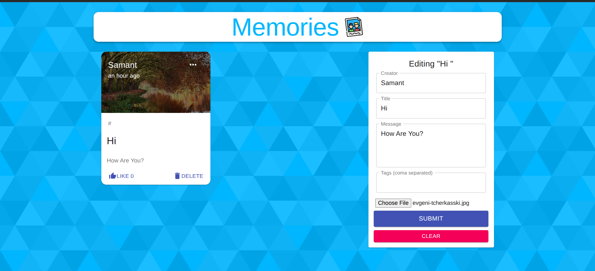

# Momento



## Introduction
Using React, Node.js, Express & MongoDB, this is a Full Stack MERN Application. The App is called "Momento" and it is a simple social media app that allows users to post interesting events that happened in their lives.

## Author / Maintainer

**Samprati Shivang**
- 🐙 GitHub: [https://github.com/StackSleuth](https://github.com/StackSleuth)


## Setup
- run ```npm i && npm start``` for both client and server side to start the app
